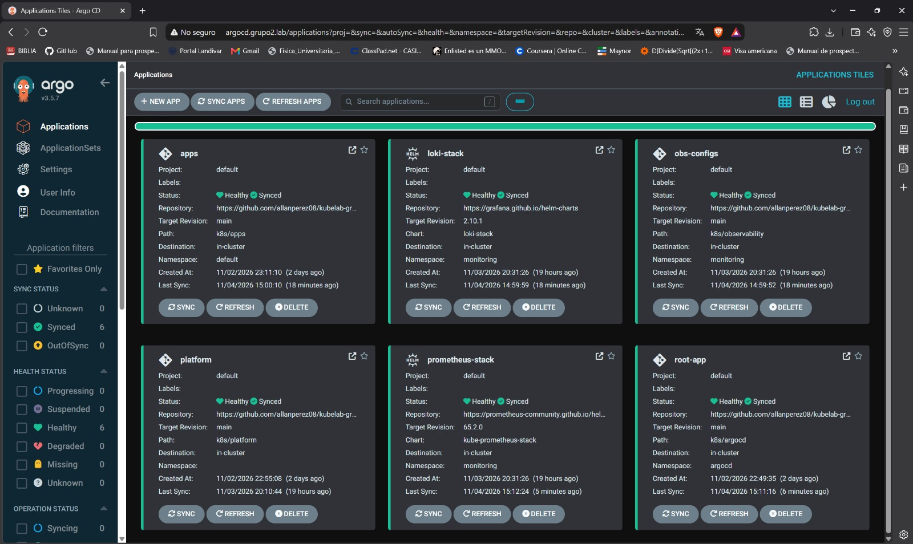
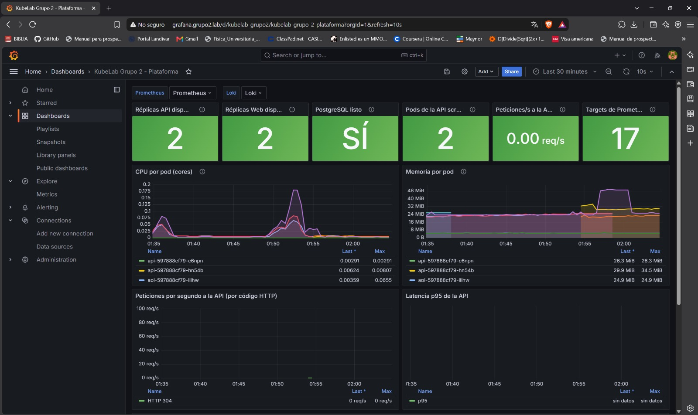

# KubeLab - Group 2

Kubernetes platform on Proxmox with GitOps, observability and centralized secrets.

Inventory application (API + web + PostgreSQL) deployed on a k3s cluster virtualized in Proxmox. GitHub Actions builds the images, Argo CD deploys them from this repository and Doppler provides the credentials.

## Architecture

```
Teacher (Tailscale) ──► pve 192.168.0.16 (subnet router) ──► lab network 192.168.0.0/24
                                                              ├─ control-plane  192.168.0.20
                                                              ├─ worker-1       192.168.0.21
                                                              └─ Traefik (MetalLB) 192.168.0.240
                                                                   ├─ app.grupo2.lab ──► web
                                                                   ├─ api.grupo2.lab ──► api ──► PostgreSQL
                                                                   ├─ db.grupo2.lab:5432 ──► PostgreSQL
                                                                   ├─ grafana / prometheus.grupo2.lab
                                                                   └─ argocd.grupo2.lab

GitHub (code + manifests) ──► GitHub Actions ──► ghcr.io (images tagged with the commit)
        └──────────────────────────────► Argo CD ──► cluster
Doppler ──► Doppler Operator ──► Kubernetes Secrets
```

| Layer | Tools |
| :--- | :--- |
| Virtualization | Proxmox VE 9.2, VMs with Ubuntu Server 26.04 LTS |
| Kubernetes | k3s `v1.30.4+k3s1` |
| Network | MetalLB (layer 2), Traefik, Tailscale |
| Applications | Node.js API, static web page, PostgreSQL 15 |
| Storage | k3s `local-path` StorageClass |
| CI/CD | GitHub Actions, GitHub Container Registry, Argo CD |
| Secrets | Doppler |
| Observability | Prometheus, Grafana, Loki, Promtail |

## Node inventory

| Name | Role | Static IP | CPU (Cores) | Memory (RAM) | Disk | In the final cluster |
| :--- | :--- | :--- | :--- | :--- | :--- | :--- |
| control-plane | Control Plane | 192.168.0.20 | 4 | 4 GB | 40 GB | Yes |
| worker-1 | Worker | 192.168.0.21 | 4 | 4.98 GB | 20 GB | Yes |
| worker-2 | Worker | 192.168.0.22 | 2 | 2 GB | 20 GB | No |
| worker-3 | Worker | 192.168.0.23 | 2 | 2 GB | 20 GB | No |

The physical computer has 8 GB of RAM, which is not enough for Proxmox, four nodes and the whole stack (Argo CD, Prometheus, Loki, Grafana, PostgreSQL). With the teacher's approval, the final cluster runs with the control plane and **one worker** (`worker-1`). `worker-2` and `worker-3` were created, configured and joined to the cluster (see [docs/cluster-setup.md](docs/cluster-setup.md)), and were then taken out of the cluster to free memory. The resources of `worker-1` were increased to 4 cores and 4.98 GB of RAM; the table shows the final values.

- Proxmox host (`pve`): `192.168.0.16`
- Gateway: `192.168.0.1`
- MetalLB pool: `192.168.0.240` - `192.168.0.250` (Traefik uses `192.168.0.240`)

## Repository structure

```
/
├── apps/
│   ├── api/              # API source code, tests and Dockerfile
│   └── web/              # Web application and Dockerfile
├── k8s/
│   ├── apps/             # api, web, database (StatefulSet, DopplerSecret, IngressRouteTCP) and HPA
│   ├── platform/         # MetalLB, Traefik values, storage class, Argo CD route
│   ├── observability/    # ServiceMonitor, Grafana dashboard, routes, Grafana secret
│   └── argocd/           # Argo CD Applications (app of apps)
├── .github/workflows/    # api-ci.yaml and web-ci.yaml
├── load-test/            # k6 script
├── docs/                 # detailed documentation, evidence and zone file
└── README.md
```

## Documentation

| Document | Content | Requirements |
| :--- | :--- | :--- |
| [docs/infra-setup.md](docs/infra-setup.md) | Proxmox, lab network, VM creation step by step | INF-01 to INF-03, INF-06 |
| [docs/cluster-setup.md](docs/cluster-setup.md) | k3s installation, why k3s, nodes | INF-04, INF-05 |
| [docs/platform-setup.md](docs/platform-setup.md) | MetalLB, Traefik, storage, Doppler, Argo CD | NET-01, NET-02, PER-01, SEC-01, SEC-02, SEC-04, CD-02 |
| [docs/applications.md](docs/applications.md) | API, web, database and routing | APP-01 to APP-07, NET-03, NET-04, PER-03 |
| [docs/observability.md](docs/observability.md) | Prometheus, Loki, Grafana and dashboard | OBS-01 to OBS-04, PER-02 |
| [docs/autoscaling.md](docs/autoscaling.md) | Replicas, PDB, HPA, pod deletion and load test | HA-01 to HA-05 |
| [docs/cicd-gitops.md](docs/cicd-gitops.md) | Pipelines, Argo CD Applications and automatic deployment | CD-01 to CD-04, SEC-03 |
| [docs/vpn-access.md](docs/vpn-access.md) | Tailscale and how to access the services | ACC-01, ACC-02 |
| [docs/hosts.txt](docs/hosts.txt) | Zone file | ACC-01 |
| [docs/ia.md](docs/ia.md) | Use of AI tools | - |

## Rebuilding the environment from scratch

1. Install Proxmox VE and create the VMs: [docs/infra-setup.md](docs/infra-setup.md).
2. Install k3s on the nodes: [docs/cluster-setup.md](docs/cluster-setup.md).
3. Configure Tailscale on Proxmox: [docs/vpn-access.md](docs/vpn-access.md).
4. Bootstrap MetalLB, Traefik, Argo CD, the Doppler Operator and the Doppler token: [docs/platform-setup.md](docs/platform-setup.md).
5. Create the root Application defined in `k8s/argocd/root-app.yaml`; Argo CD deploys everything else from this repository: [docs/cicd-gitops.md](docs/cicd-gitops.md).
6. Copy the zone file `docs/hosts.txt` into the hosts file and open the URLs below.

## URL table

All domains point to the Traefik IP `192.168.0.240` (see [docs/hosts.txt](docs/hosts.txt)).

| URL | Service | What you should see |
| :--- | :--- | :--- |
| http://app.grupo2.lab | Web application | Inventory page to list, create, edit and delete items |
| http://api.grupo2.lab/health | API | Health response of the API |
| http://api.grupo2.lab/api/items | API | Items in JSON |
| `db.grupo2.lab:5432` | PostgreSQL | Connection from a SQL client (DBeaver, psql) |
| http://grafana.grupo2.lab | Grafana | Dashboard *KubeLab Grupo 2 - Plataforma* |
| http://prometheus.grupo2.lab | Prometheus | Targets in UP state |
| http://argocd.grupo2.lab | Argo CD | Applications Synced and Healthy |
| https://192.168.0.16:8006 | Proxmox VE | The `pve` node and its VMs |

## Access

1. Join the VPN and copy the zone file following [docs/vpn-access.md](docs/vpn-access.md).
2. Open the URLs from the table above.

Read-only users for the database, Grafana and Argo CD are shared through a private channel and are not in this repository.

## Evidence

| Evidence | Where |
| :--- | :--- |
| Autoscaling with a load test (video) | [Google Drive](https://drive.google.com/file/d/1mBFlpBRF54H0yRtS7iE8Cd1SFZ_gxdUK/view?usp=sharing) and [docs/autoscaling.md](docs/autoscaling.md) |
| Pod deletion without service loss | [docs/autoscaling.md](docs/autoscaling.md) |
| Automatic deployment from a commit | [docs/cicd-gitops.md](docs/cicd-gitops.md) |
| Database access through Traefik | [docs/applications.md](docs/applications.md) |




