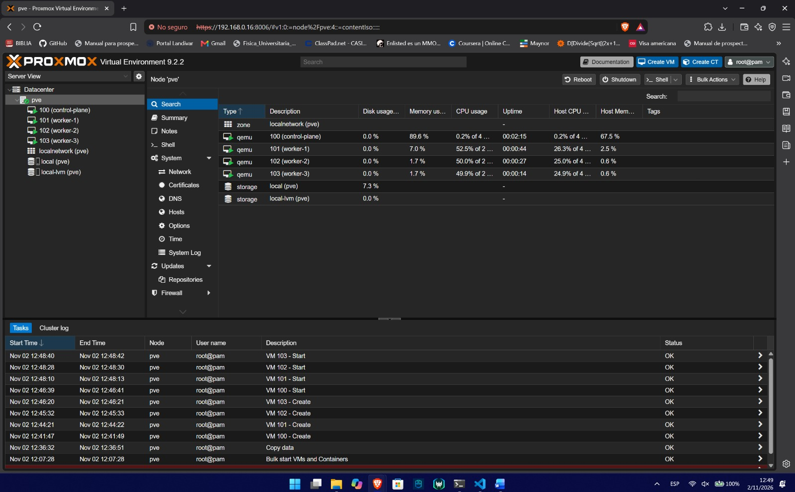
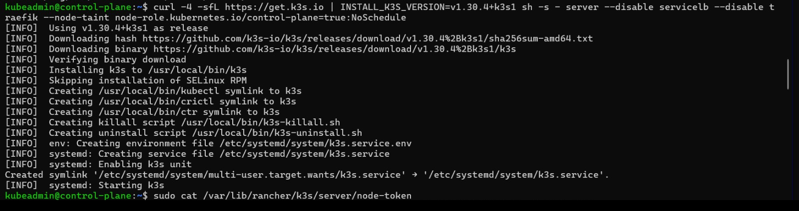
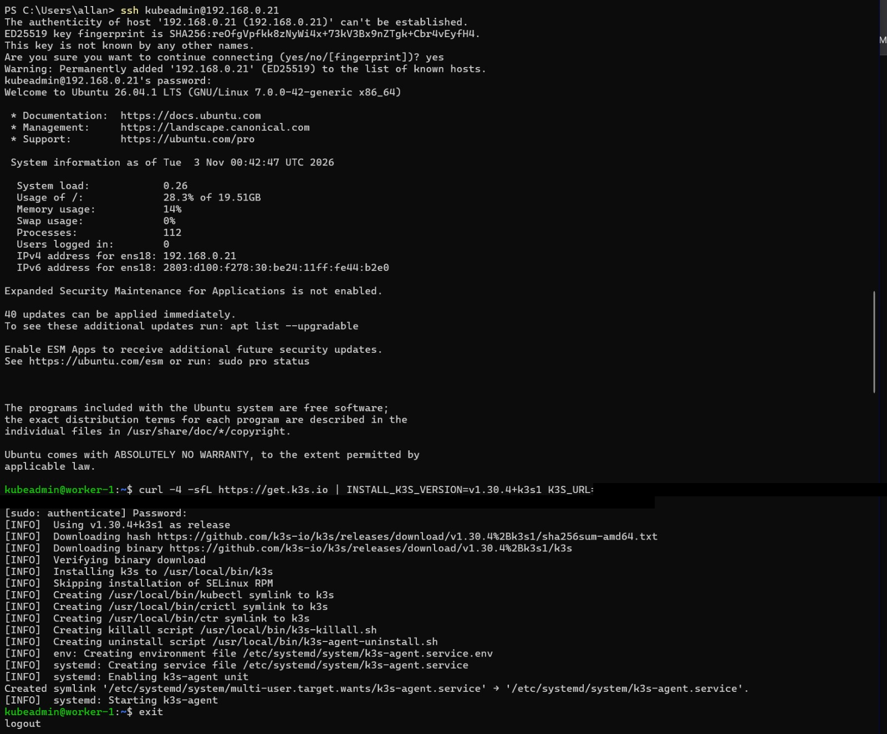
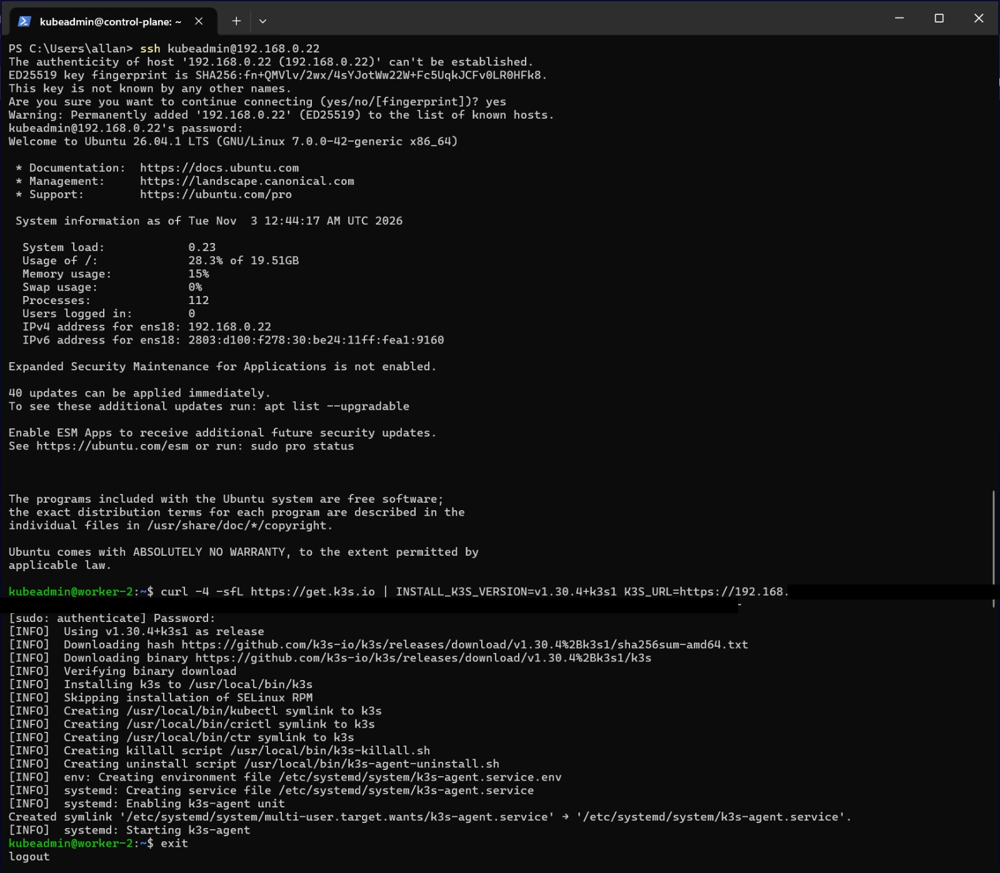
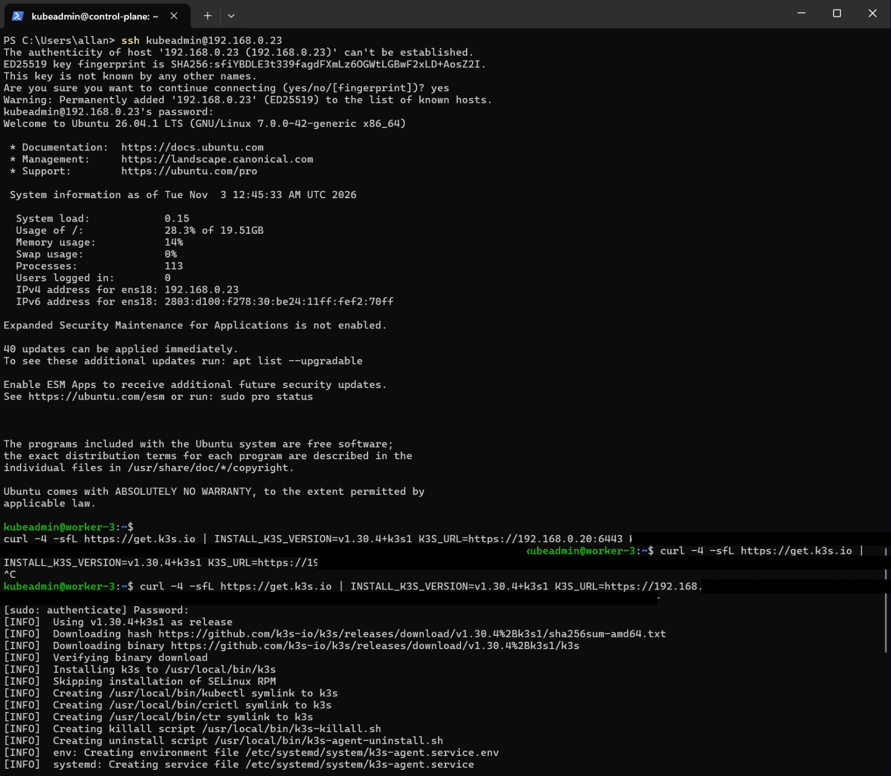
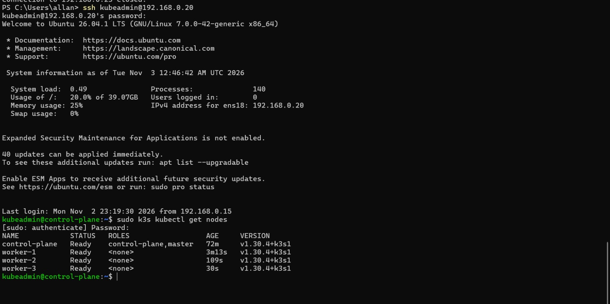

# KubeLab - Group 2

Kubernetes platform on Proxmox with GitOps, observability and centralized secrets.

## Architecture

The physical computer runs Proxmox VE 9.2. Proxmox hosts 4 virtual machines with Ubuntu Server 26.04 LTS that form the Kubernetes cluster (k3s). Access from outside the lab network is provided by Tailscale, using the Proxmox host as a subnet router.

```
Teacher (Tailscale) ──► pve 192.168.0.16 (subnet router) ──► lab network 192.168.0.0/24
                                                              ├─ control-plane  192.168.0.20
                                                              ├─ worker-1       192.168.0.21
                                                              ├─ worker-2       192.168.0.22
                                                              ├─ worker-3       192.168.0.23
                                                              └─ Traefik (MetalLB) 192.168.0.240
```

### Lab network

| Item | Value |
| :--- | :--- |
| Subnet | `192.168.0.0/24` |
| Gateway | `192.168.0.1` (Trendnet router) |
| Proxmox host (`pve`) | `192.168.0.16` |
| Cluster nodes | `192.168.0.20` to `192.168.0.23` |
| Router DHCP range | `192.168.0.100` to `192.168.0.199` |
| MetalLB pool (INF-06) | `192.168.0.240` to `192.168.0.250` |
| Domain | `grupo2.lab` |

The router DHCP range is kept apart from the static IPs and the MetalLB pool, so the router never hands out an address that is already in use.

On the day of the presentation everything is plugged into the Trendnet router, which keeps the same `192.168.0.0/24` network no matter where the internet comes from (the university cable on the WAN port, or a laptop sharing a phone's mobile data). This way the static IPs never change.

### Node inventory

| Name | VM ID | Role | Static IP | CPU (cores) | Memory | Disk |
| :--- | :--- | :--- | :--- | :--- | :--- | :--- |
| control-plane | 100 | Control Plane | 192.168.0.20 | 4 | 4 GB | 40 GB |
| worker-1 | 101 | Worker | 192.168.0.21 | 2 | 2 GB | 20 GB |
| worker-2 | 102 | Worker | 192.168.0.22 | 2 | 2 GB | 20 GB |
| worker-3 | 103 | Worker | 192.168.0.23 | 2 | 2 GB | 20 GB |



### VM creation (INF-03)

1. The Ubuntu Server 26.04 LTS (64-bit) ISO was uploaded to the `local (pve)` storage.
2. The 4 VMs were created with **Create VM** in the Proxmox UI.
3. In **OS**, the Ubuntu ISO was selected.
4. Disk, CPU and memory were set according to the node inventory.
5. In **Network**, the default bridge `vmbr0` was kept.
6. During the Ubuntu installation, manual IPv4 was configured with each node's static IP and gateway `192.168.0.1`.
7. OpenSSH Server was installed on every node.

The step-by-step guide with screenshots is in [docs/infra-setup.md](docs/infra-setup.md).

## Kubernetes cluster (INF-04 and INF-05)

### Why k3s

We chose **k3s** because:

- It is a certified Kubernetes distribution, so the same manifests, Kustomize and Argo CD work as on any other cluster.
- It is a single lightweight binary. Our workers only have 2 GB of RAM, and k3s uses much less memory than a full kubeadm installation.
- Installing it and joining workers takes one command per node, which makes the cluster easy to rebuild from scratch.
- It ships with containerd and a CNI ready to use. We disabled its bundled Traefik and ServiceLB because we install MetalLB and our own Traefik from the repository.

### Installation

The cluster runs k3s `v1.30.4+k3s1`.

On the control plane, k3s was installed as a server without its bundled Traefik and ServiceLB, and with the taint `node-role.kubernetes.io/control-plane=true:NoSchedule`, so application workloads are never scheduled on it:

```bash
curl -4 -sfL https://get.k3s.io | INSTALL_K3S_VERSION=v1.30.4+k3s1 sh -s - server \
  --disable servicelb \
  --disable traefik \
  --node-taint node-role.kubernetes.io/control-plane=true:NoSchedule
```

The node token is read on the control plane:

```bash
sudo cat /var/lib/rancher/k3s/server/node-token
```

Each worker joined the cluster as an agent over IPv4 using that token:

```bash
curl -4 -sfL https://get.k3s.io | INSTALL_K3S_VERSION=v1.30.4+k3s1 \
  K3S_URL=https://192.168.0.20:6443 \
  K3S_TOKEN=<node-token> sh -
```


Verification on the control plane:

```bash
sudo k3s kubectl get nodes
```

### Evidence

Control plane installation and taint:



Workers joining the cluster:

| worker-1 | worker-2 | worker-3 |
| :---: | :---: | :---: |
|  |  |  |

All 4 nodes in `Ready` status:



```
NAME            STATUS   ROLES                  AGE    VERSION
control-plane   Ready    control-plane,master   72m    v1.30.4+k3s1
worker-1        Ready    <none>                 3m13s  v1.30.4+k3s1
worker-2        Ready    <none>                 109s   v1.30.4+k3s1
worker-3        Ready    <none>                 30s    v1.30.4+k3s1
```

## VPN access (ACC-02)

Tailscale is installed on the Proxmox host and advertises the `192.168.0.0/24` route. The teacher only has to install Tailscale, accept the invitation and copy `docs/hosts.txt`; no manual routes are needed.

We first tried ZeroTier, but its free plan no longer allows Managed Routes, so we switched to Tailscale.

The full configuration and instructions are in [docs/vpn-access.md](docs/vpn-access.md).

## Rebuilding the environment from scratch

1. Install Proxmox VE on the physical computer with IP `192.168.0.16`.
2. Create the 4 VMs following [docs/infra-setup.md](docs/infra-setup.md).
3. Configure Tailscale on Proxmox following [docs/vpn-access.md](docs/vpn-access.md).
4. Install k3s on the control plane with the `NoSchedule` taint and join the 3 workers with the node token (see the Kubernetes cluster section).
5. Platform (MetalLB, Traefik, storage, Doppler): pending.
6. Argo CD and applications: pending.

## URL table

All domains point to the Traefik IP (`192.168.0.240`), see [docs/hosts.txt](docs/hosts.txt).

| URL | Service | What you should see | Status |
| :--- | :--- | :--- | :--- |
| https://192.168.0.16:8006 | Proxmox VE | Proxmox dashboard with the `pve` node and the 4 VMs | Working |
| http://app.grupo2.lab | Web application | Page to list, create, edit and delete records | Pending |
| http://api.grupo2.lab/health | API | API health response | Pending |
| db.grupo2.lab | Database | Connection from a SQL client | Pending |
| http://grafana.grupo2.lab | Grafana | Dashboard with CPU, memory, replicas, requests and logs | Pending |
| http://prometheus.grupo2.lab | Prometheus | Targets in UP state | Pending |
| http://argocd.grupo2.lab | Argo CD | Applications in Synced and Healthy state | Pending |

## Access instructions

1. Join the VPN following [docs/vpn-access.md](docs/vpn-access.md).
2. Copy the content of [docs/hosts.txt](docs/hosts.txt) into your hosts file:
   - Windows: `C:\Windows\System32\drivers\etc\hosts` (open Notepad as administrator).
   - Linux / macOS: `/etc/hosts`.
3. Open the URLs from the table above.

Read-only users for the database, Grafana and Argo CD are shared through a private channel.
