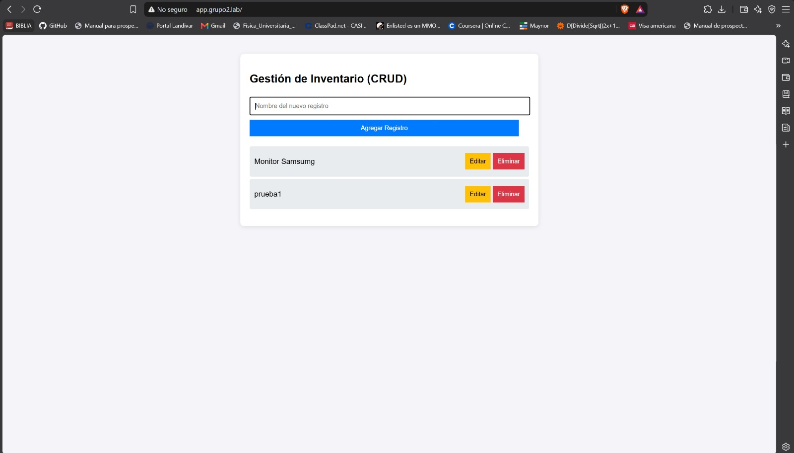
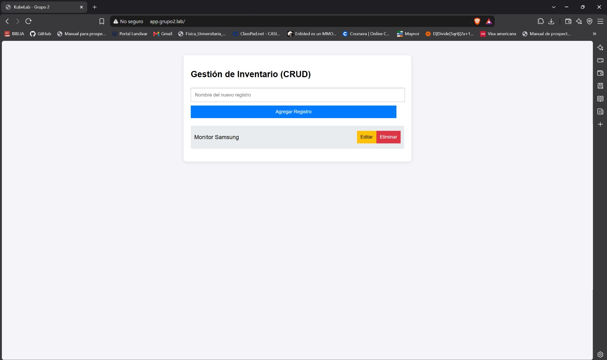
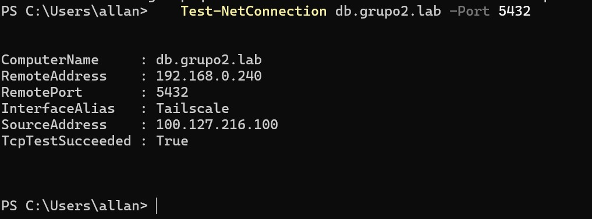
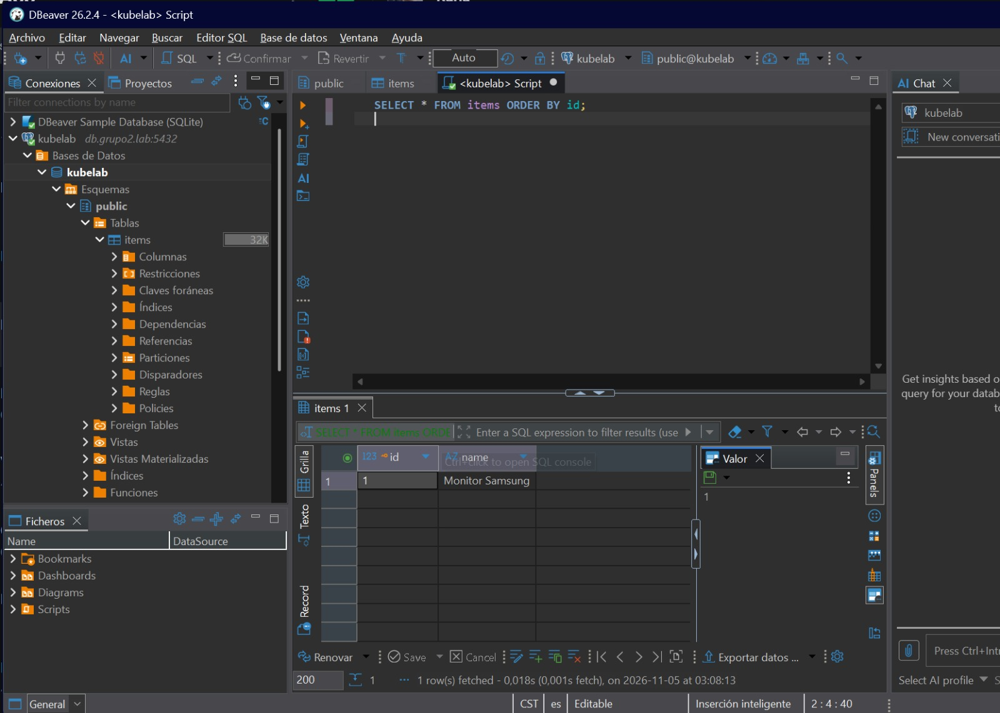

# Applications and routing (APP-01 to APP-07, NET-03, NET-04)

## Components

| Component | Code | Manifest | Image | Domain |
| :--- | :--- | :--- | :--- | :--- |
| API (Node.js, Express) | `apps/api/` | `k8s/apps/api.yaml` | `ghcr.io/allanperez08/kubelab-api:<commit>` | `api.grupo2.lab` |
| Web (static page) | `apps/web/` | `k8s/apps/web.yaml` | `ghcr.io/allanperez08/kubelab-web:<commit>` | `app.grupo2.lab` |
| PostgreSQL 15 | - | `k8s/apps/database/postgres.yaml` | `postgres:15-alpine` | `db.grupo2.lab:5432` |

The application manages an inventory; the main entity is `items`.

## API (APP-01)

| Method | Route | Use |
| :--- | :--- | :--- |
| GET | `/api/items` | list |
| POST | `/api/items` | create |
| PUT | `/api/items/:id` | update |
| DELETE | `/api/items/:id` | delete |
| GET | `/health` | health check (used by the probes) |
| GET | `/metrics` | Prometheus metrics (`http_requests_total`, `http_request_duration_seconds`) |

The API creates the `items` table automatically (`CREATE TABLE IF NOT EXISTS`) before it runs its first query, so the initial schema is applied without manual steps (APP-07). Its unit tests run in the pipeline before the image is built.

## Web (APP-02)

The page at `http://app.grupo2.lab` lists, creates, edits and deletes items through the API.



## Images (APP-04, APP-05)

Each application has its own Dockerfile. GitHub Actions publishes the images to GitHub Container Registry tagged with the short commit hash. `latest` is never used. See [cicd-gitops.md](cicd-gitops.md).

## Database (APP-03, PER-03)

- StatefulSet `postgres` with a 2 Gi PVC on the `local-path` class, so the data survives if the pod is deleted.
- Credentials come from `postgres-secret`, synced by Doppler.
- `startupProbe`, `readinessProbe` and `livenessProbe` with `pg_isready`.
- `appArmorProfile: Unconfined` only on this pod. On Ubuntu 26.04 the default containerd AppArmor profile blocks signals inside the container and PostgreSQL could not start. The details are in [ia.md](ia.md).

## Routing (NET-03, NET-04)

All the traffic enters through Traefik on `192.168.0.240`.

| Domain | Resource | File | Backend |
| :--- | :--- | :--- | :--- |
| `app.grupo2.lab` | IngressRoute | `k8s/apps/web.yaml` | `web:80` |
| `api.grupo2.lab` | IngressRoute | `k8s/apps/api.yaml` | `api:80` |
| `grafana.grupo2.lab` | IngressRoute | `k8s/observability/ingress.yaml` | Grafana |
| `prometheus.grupo2.lab` | IngressRoute | `k8s/observability/ingress.yaml` | Prometheus |
| `argocd.grupo2.lab` | IngressRoute | `k8s/platform/argocd-ingress.yaml` | `argocd-server:80` |
| `db.grupo2.lab:5432` | IngressRouteTCP | `k8s/apps/database/postgres-ingress.yaml` | `postgres:5432` |

PostgreSQL does not send a host name, so the TCP route uses `HostSNI(*)` on the `postgres` entry point.

## Database access test (NET-04)

From a laptop on Tailscale with the zone file:

1. A record created from the web page:



2. Port 5432 of `db.grupo2.lab` answers through the VPN (`192.168.0.240`):

```powershell
Test-NetConnection db.grupo2.lab -Port 5432
```



3. The same record seen from DBeaver connected to `db.grupo2.lab:5432`:


