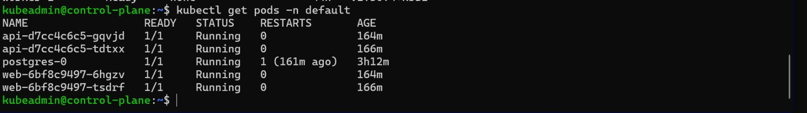
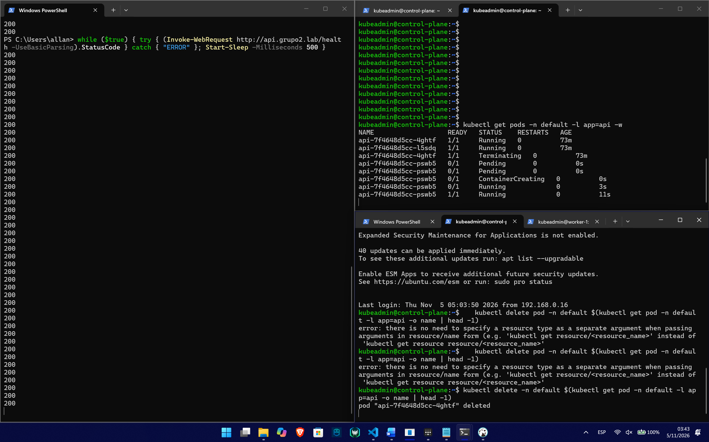
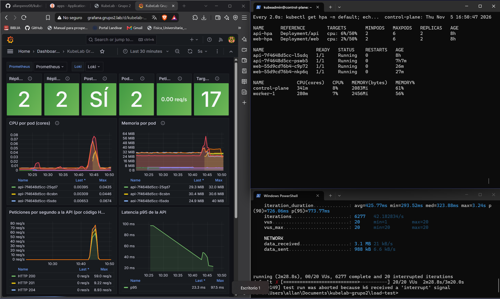

# Autoscaling and load test (HA-01 to HA-05)

## What is configured

| Requirement | Where | Detail |
| :--- | :--- | :--- |
| HA-01 | `k8s/apps/api.yaml`, `k8s/apps/web.yaml` | 2 replicas each |
| HA-02 | same files | CPU/memory `requests` and `limits`, `readinessProbe` and `livenessProbe` |
| HA-03 | same files | `PodDisruptionBudget` with `minAvailable: 1` |
| HA-04 | `k8s/apps/hpa.yaml` | One HPA per application: minimum 2, maximum 6 replicas, target 50 % CPU. metrics-server is the one bundled with k3s |
| HA-05 | `load-test/k6-api.js` | k6 script that sends sustained traffic to the API |

The cluster has a single worker, so scale-up is gradual (2 pods every 30 seconds) and the script stops by itself if more than 20 % of the requests fail.

## Argo CD and the HPA

Argo CD has `selfHeal` enabled, so a manual change such as `kubectl scale` is reverted. The HPA also changes `spec.replicas`, so `k8s/argocd/apps-app.yaml` ignores only the changes made by the HPA controller (`ignoreDifferences` with `managedFieldsManagers`) and honors that rule when syncing (`RespectIgnoreDifferences=true`). A manual `kubectl scale` is still reverted.

## Run the load test

On a computer that can reach `api.grupo2.lab` (VPN and zone file from [vpn-access.md](vpn-access.md)):

```bash
k6 run load-test/k6-api.js
# lighter run:
k6 run -e MAX_VUS=20 load-test/k6-api.js
```

While it runs, in the control plane:

```bash
kubectl get hpa -n default -w
kubectl get pods -n default -w
kubectl top nodes
```

Expected behavior: CPU of the `api` pods rises above 50 %, the HPA adds replicas (up to 6) and, about two minutes after the test ends, goes back to 2. The dashboard *KubeLab Grupo 2 - Plataforma* in Grafana shows the same thing (available replicas, CPU per pod, requests per second).

Each iteration creates, edits and deletes its own test record, so the database is left clean.

## Evidence

### Replicas (HA-01)

API and web with 2 replicas each, next to PostgreSQL:



### Deleting a pod (HA-03)

While a loop calls `http://api.grupo2.lab/health` every half second, an API pod is deleted:

```bash
kubectl delete -n default $(kubectl get pod -n default -l app=api -o name | head -1)
```

The other replica keeps answering `200` and Kubernetes creates a new pod in a few seconds.



### Autoscaling with k6 (HA-04, HA-05)

Video of the load test:
[ev-autoscaling.mp4 (Google Drive)](https://drive.google.com/file/d/1mBFlpBRF54H0yRtS7iE8Cd1SFZ_gxdUK/view?usp=sharing)

State after the test: the k6 summary, and the HPA back to its minimum of 2 replicas once the CPU usage went down.


