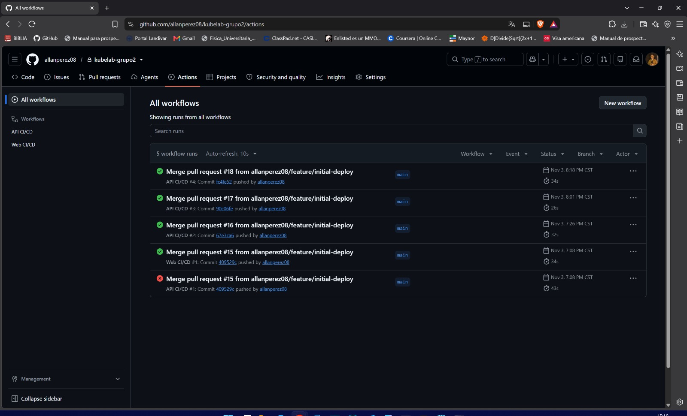
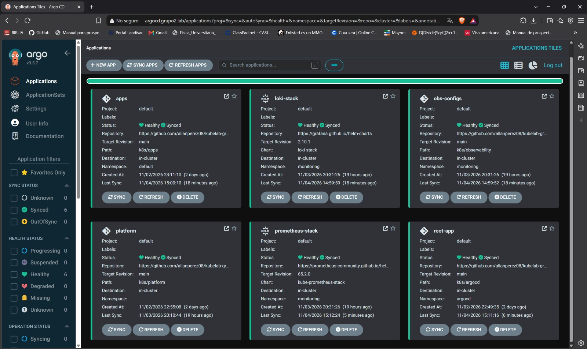
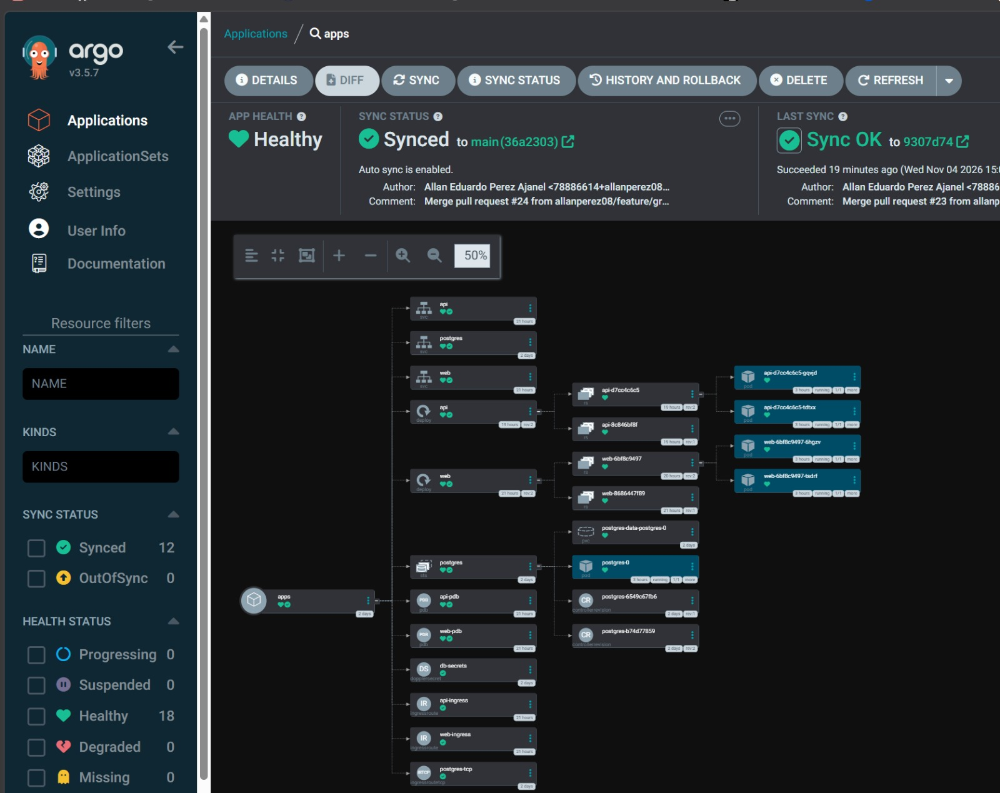
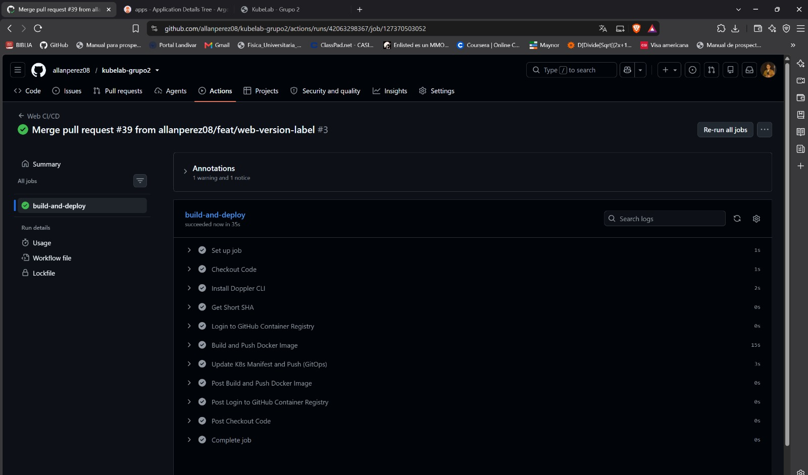
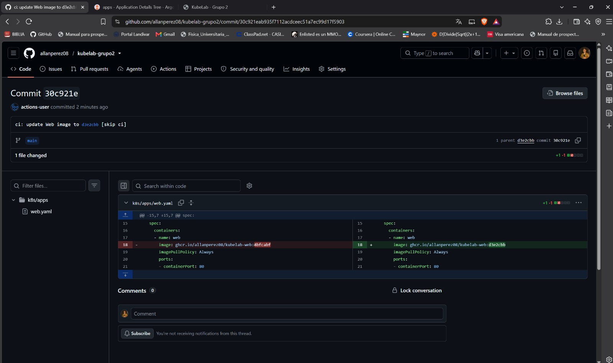
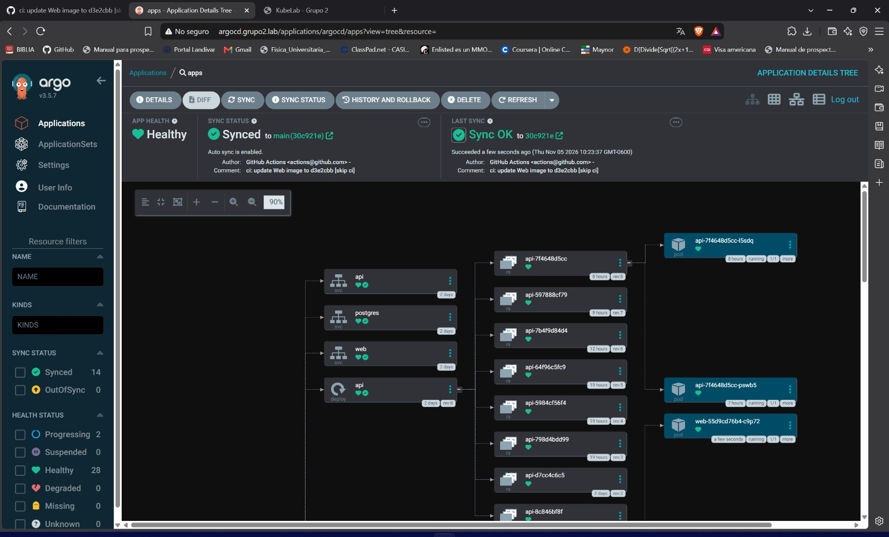
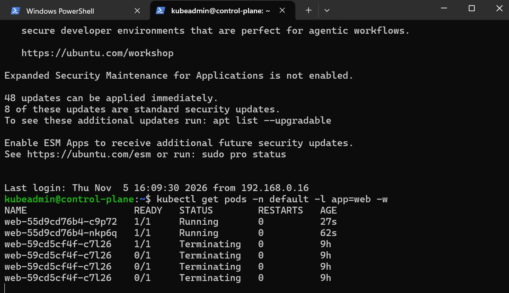
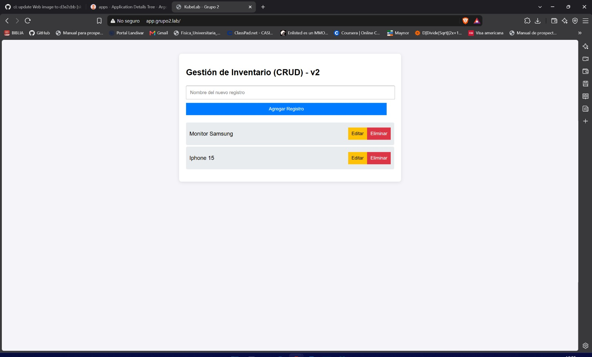
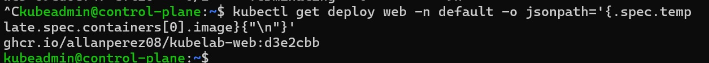

# CI/CD and GitOps (CD-01 to CD-04, SEC-03)

## Flow

1. A pull request with changes in `apps/api/` or `apps/web/` is merged into `main`.
2. Only the workflow of that application runs (`paths` filter).
3. The workflow runs the tests (API), builds the image and pushes it to `ghcr.io` with the short commit hash.
4. It updates the image tag in `k8s/apps/api.yaml` or `k8s/apps/web.yaml` and commits that change to `main` (`ci: update ... [skip ci]`).
5. Argo CD sees the new commit and syncs. Kubernetes replaces the pods with a RollingUpdate.
6. A change that only touches manifests is applied by Argo CD directly, without building images.

## Workflows (CD-01, SEC-03)

| File | Runs when | Steps |
| :--- | :--- | :--- |
| `.github/workflows/api-ci.yaml` | push to `main` in `apps/api/**` | tests, build, push, update `k8s/apps/api.yaml` |
| `.github/workflows/web-ci.yaml` | push to `main` in `apps/web/**` | build, push, update `k8s/apps/web.yaml` |

The pipelines get their credentials from Doppler (SEC-03). Apart from the built-in `GITHUB_TOKEN` used to push the image to `ghcr.io`, the only repository secret is `DOPPLER_TOKEN`; the token used to push the manifest commit (`GIT_PAT`) is read with the Doppler CLI.

## Argo CD Applications (CD-03, CD-04)

App of apps: `root-app` points to `k8s/argocd/` and creates the rest.

| Application | Source | Namespace |
| :--- | :--- | :--- |
| `root-app` | `k8s/argocd` | `argocd` |
| `platform` | `k8s/platform` | - |
| `apps` | `k8s/apps` (API, web, database) | `default` |
| `obs-configs` | `k8s/observability` | `monitoring` |
| `prometheus-stack` | Helm chart `kube-prometheus-stack` 65.2.0 | `monitoring` |
| `loki-stack` | Helm chart `loki-stack` 2.10.1 | `monitoring` |

All of them have automated sync with `prune` and `selfHeal`, so a manual change in the cluster is reverted. The `apps` Application ignores only the replica changes made by the HPA controller, so autoscaling works while a manual `kubectl scale` is still reverted.

Tree of the `apps` Application, with the API and web Deployments and Pods and the PostgreSQL StatefulSet:

## Automatic deployment evidence

Change of the page title of the web application (`feat(web): show the app version in the page title`, PR #39).

1. The PR is merged and the `Web CI/CD` workflow runs:

2. The workflow commits the new image tag to `k8s/apps/web.yaml`:

3. Argo CD syncs the new commit:

4. RollingUpdate: the new pods start and the old ones terminate:

5. The page shows the new version (`v2`):

6. The Deployment uses the image tagged with the commit hash:

