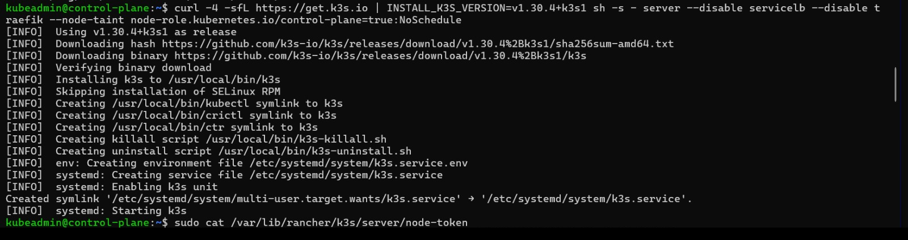
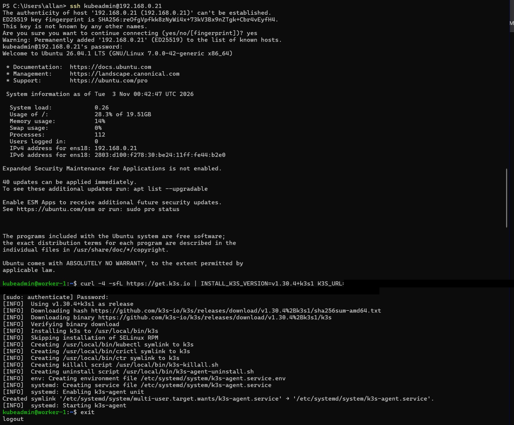
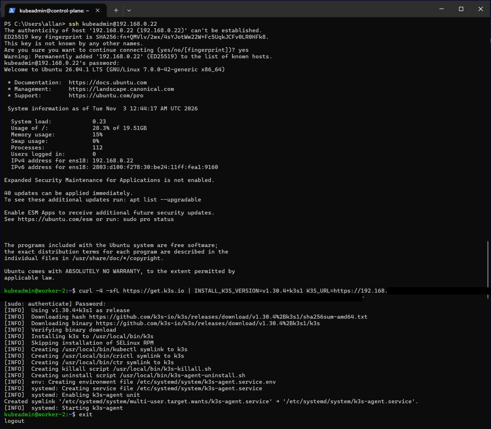
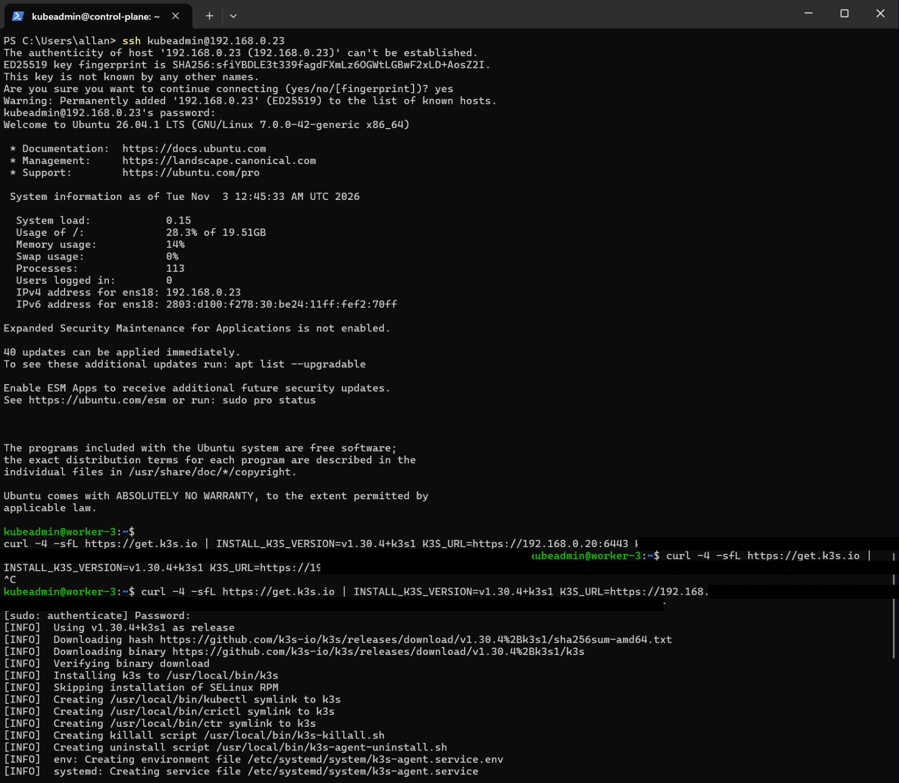
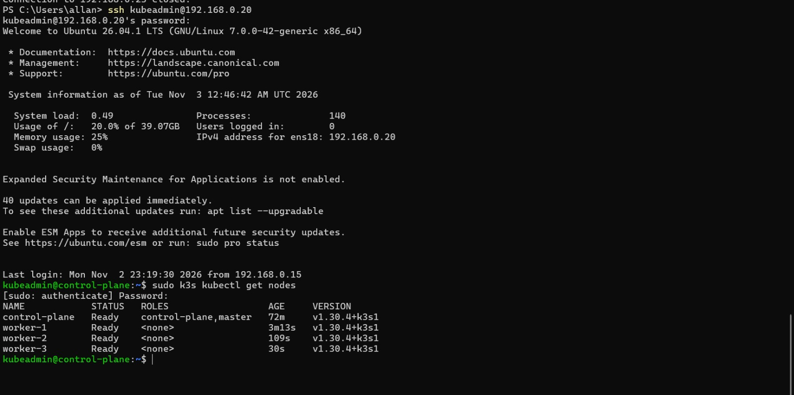
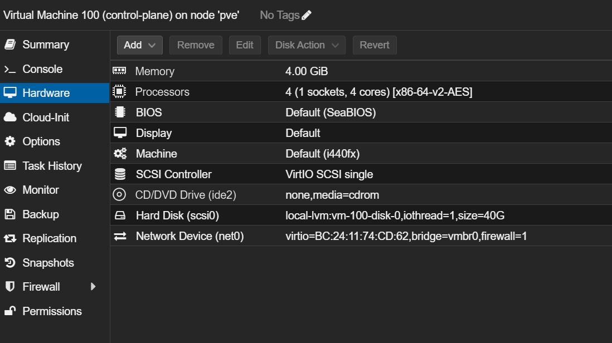
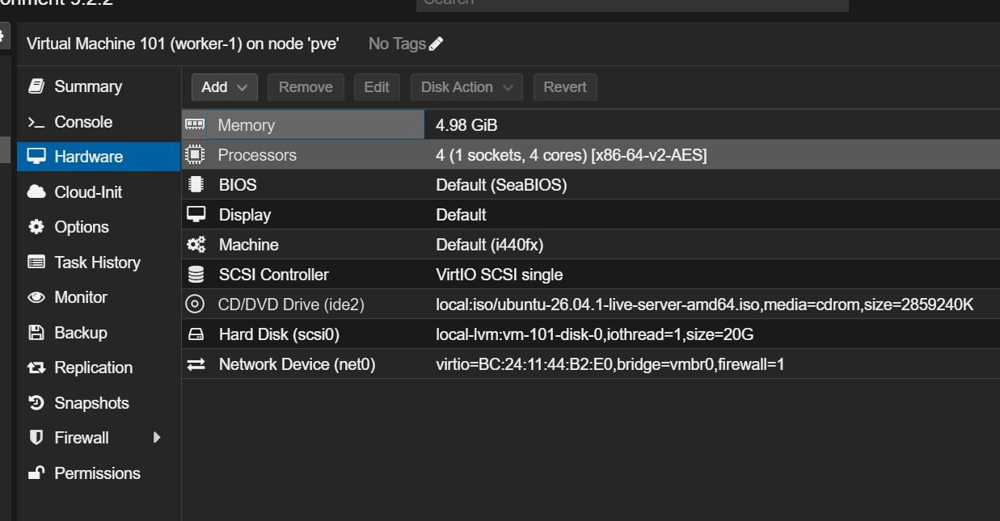
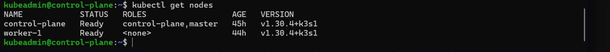

# Kubernetes cluster (INF-04 and INF-05)

## Why k3s

We chose **k3s** because:

- It is a certified Kubernetes distribution, so the same manifests, Kustomize and Argo CD work as on any other cluster.
- It is a single lightweight binary. Our workers only have 2 GB of RAM, and k3s uses much less memory than a full kubeadm installation.
- Installing it and joining workers takes one command per node, which makes the cluster easy to rebuild from scratch.
- It ships with containerd and a CNI ready to use. We disabled its bundled Traefik and ServiceLB because we install MetalLB and our own Traefik from the repository.

## Control plane

k3s `v1.30.4+k3s1` was installed as a server without its bundled Traefik and ServiceLB, and with the taint `node-role.kubernetes.io/control-plane=true:NoSchedule`, so application workloads are never scheduled on the control plane:

```bash
curl -4 -sfL https://get.k3s.io | INSTALL_K3S_VERSION=v1.30.4+k3s1 sh -s - server \
  --disable servicelb \
  --disable traefik \
  --node-taint node-role.kubernetes.io/control-plane=true:NoSchedule
```

The node token used by the workers is read on the control plane:

```bash
sudo cat /var/lib/rancher/k3s/server/node-token
```

The node token is a credential, so it is not stored in this repository and it is hidden in the screenshots.



## Workers

Each worker joined the cluster as an agent over IPv4 using the node token:

```bash
curl -4 -sfL https://get.k3s.io | INSTALL_K3S_VERSION=v1.30.4+k3s1 \
  K3S_URL=https://192.168.0.20:6443 \
  K3S_TOKEN=<node-token> sh -
```

### worker-1



### worker-2



### worker-3



## Verification (all 4 nodes, before the change)

On the control plane:

```bash
sudo k3s kubectl get nodes
```

```
NAME            STATUS   ROLES                  AGE    VERSION
control-plane   Ready    control-plane,master   72m    v1.30.4+k3s1
worker-1        Ready    <none>                 3m13s  v1.30.4+k3s1
worker-2        Ready    <none>                 109s   v1.30.4+k3s1
worker-3        Ready    <none>                 30s    v1.30.4+k3s1
```



## Final cluster: one worker

The physical computer has 8 GB of RAM, which is not enough for Proxmox, four nodes and the whole stack (Argo CD, Prometheus, Loki, Grafana, PostgreSQL). With the teacher's approval, the final cluster runs with the control plane and **one worker** (`worker-1`). `worker-2` and `worker-3` were created, configured and joined to the cluster (see the sections above), and were then taken out of the cluster to free memory.

The control plane keeps its `NoSchedule` taint, so all the application workloads run on `worker-1`.

| Node | CPU (cores) | Memory | Disk |
| :--- | :--- | :--- | :--- |
| control-plane | 4 | 4 GB (unchanged) | 40 GB |
| worker-1 | 4 (was 2) | 4.98 GB (was 2 GB) | 20 GB |

Procedure used to take `worker-2` and `worker-3` out of the cluster:

1. In Proxmox, each VM was shut down (right-click on the VM → **Shutdown**).
2. On the control plane, each node was removed from the cluster:

```bash
sudo kubectl delete node worker-2
sudo kubectl delete node worker-3
```

3. In Proxmox, the memory and cores of `worker-1` were increased (**Hardware → Memory** and **Processors**).

Final hardware of the control plane:



Final hardware of `worker-1`:



`kubectl get nodes` during the final tests:


