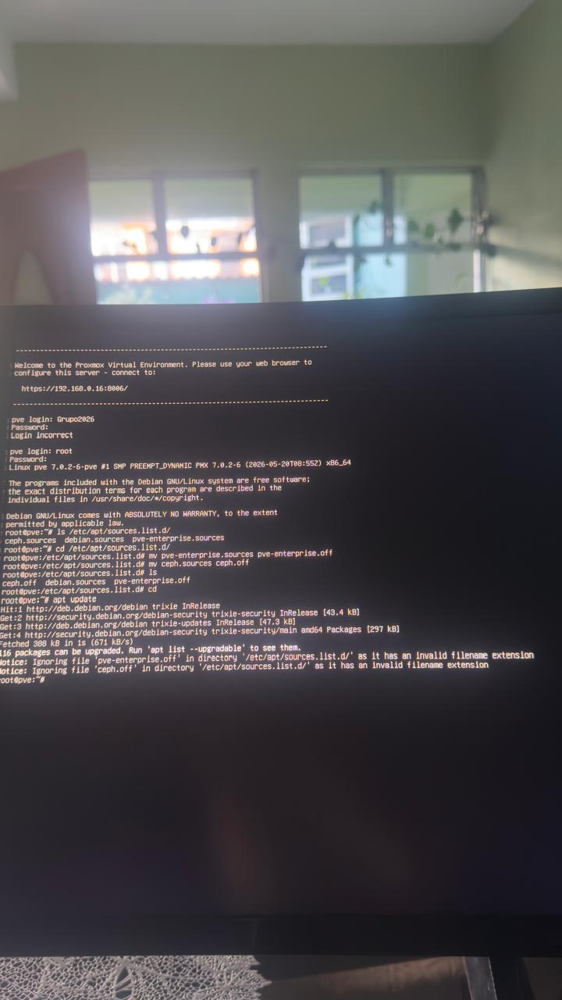
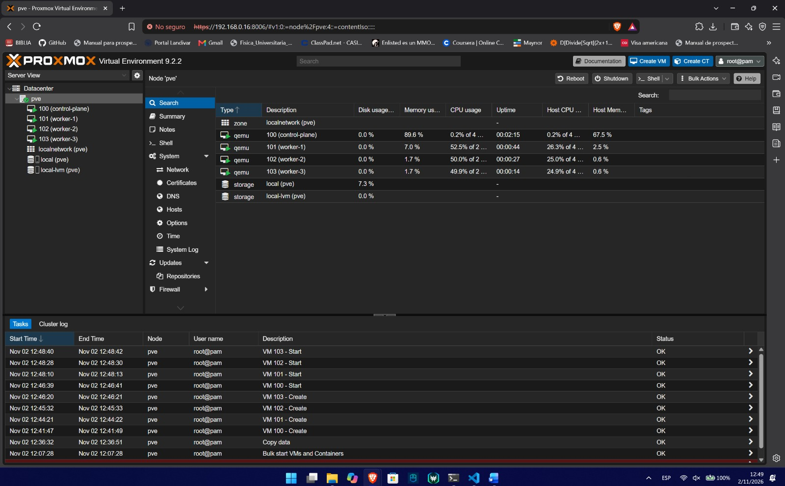
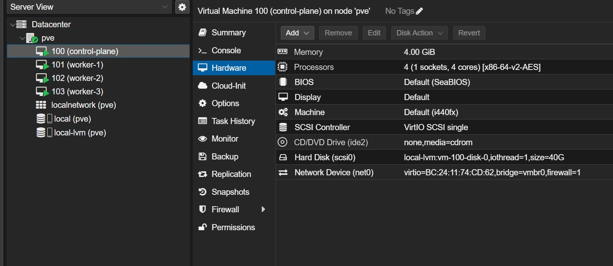
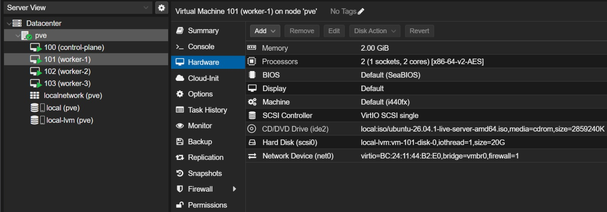
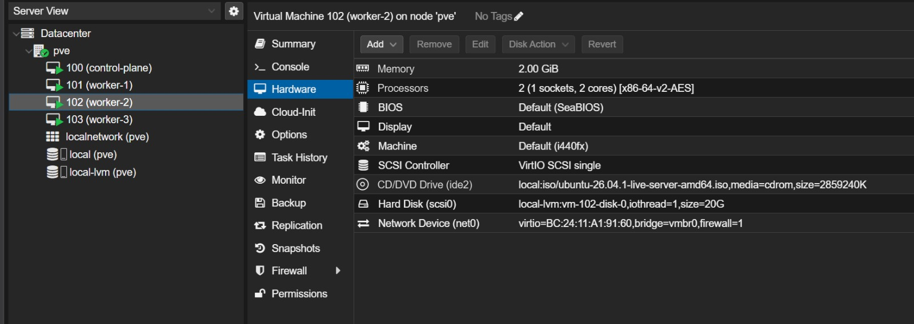
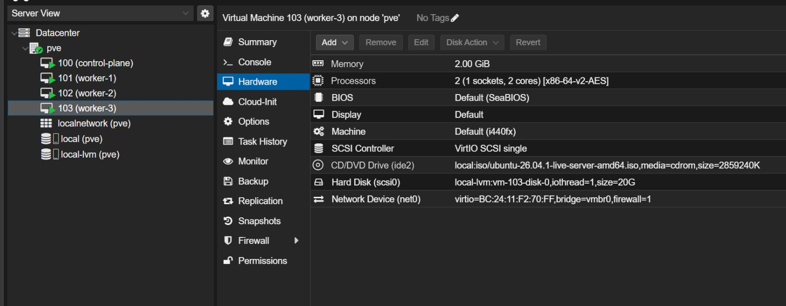
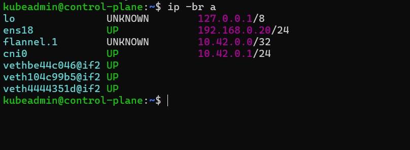
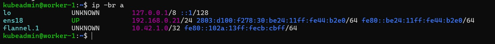
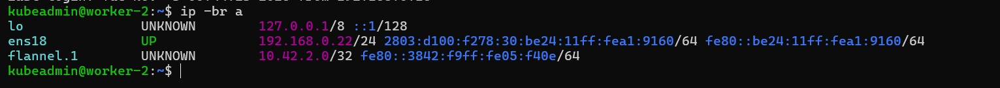
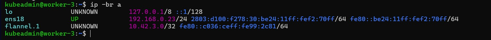

# Infrastructure setup (INF-01 to INF-03, INF-06)

## Proxmox

Proxmox VE 9.2 is installed directly on the physical computer, with static IP `192.168.0.16` on the `vmbr0` bridge and gateway `192.168.0.1`. The web interface is at `https://192.168.0.16:8006`.

Since we don't have a subscription, the enterprise repositories were disabled so `apt update` works with the Debian repositories:

```bash
cd /etc/apt/sources.list.d/
mv pve-enterprise.sources pve-enterprise.off
mv ceph.sources ceph.off
apt update
```





## Lab network

| Item | Value |
| :--- | :--- |
| Subnet | `192.168.0.0/24` |
| Gateway | `192.168.0.1` (Trendnet router) |
| Proxmox host (`pve`) | `192.168.0.16` |
| Cluster nodes | `192.168.0.20` to `192.168.0.23` |
| Router DHCP range | `192.168.0.100` to `192.168.0.199` |
| MetalLB pool (INF-06) | `192.168.0.240` to `192.168.0.250` |
| Traefik IP | `192.168.0.240` |
| Domain | `grupo2.lab` |

The router DHCP range is kept apart from the static IPs and the MetalLB pool, so the router never hands out an address that is already in use.

On the day of the presentation everything is plugged into the Trendnet router, which keeps the same `192.168.0.0/24` network no matter where the internet comes from (the university cable on the WAN port, or a laptop sharing a phone's mobile data). This way the static IPs never change.

## Node inventory

| Name | VM ID | Role | Static IP | CPU (cores) | Memory | Disk |
| :--- | :--- | :--- | :--- | :--- | :--- | :--- |
| control-plane | 100 | Control Plane | 192.168.0.20 | 4 | 4 GB | 40 GB |
| worker-1 | 101 | Worker | 192.168.0.21 | 2 | 2 GB | 20 GB |
| worker-2 | 102 | Worker | 192.168.0.22 | 2 | 2 GB | 20 GB |
| worker-3 | 103 | Worker | 192.168.0.23 | 2 | 2 GB | 20 GB |

## VM creation

The 4 VMs were created the same way with **Create VM** in the Proxmox UI. Only the name, ID, resources and IP change.

1. The Ubuntu Server 26.04 LTS (64-bit) ISO was uploaded to the `local (pve)` storage.
2. **General:** node `pve`, VM ID and name.
3. **OS:** Ubuntu Server ISO from `local (pve)`, type Linux.
4. **System:** default values.
5. **Disks:** 40 GB for the control plane, 20 GB for the workers, on `local-lvm`.
6. **CPU:** 4 cores for the control plane, 2 for the workers.
7. **Memory:** 4096 MB for the control plane, 2048 MB for the workers.
8. **Network:** bridge `vmbr0`, VirtIO model.
9. **Confirm:** the summary was checked and the VM was created.

Final hardware of each VM in Proxmox:

### control-plane (100)



### worker-1 (101)



### worker-2 (102)



### worker-3 (103)



## Ubuntu installation and static IP

During the Ubuntu Server installation the network was set to manual IPv4:

| Node | IP | Mask | Gateway | DNS |
| :--- | :--- | :--- | :--- | :--- |
| control-plane | 192.168.0.20 | /24 | 192.168.0.1 | 8.8.8.8 |
| worker-1 | 192.168.0.21 | /24 | 192.168.0.1 | 8.8.8.8 |
| worker-2 | 192.168.0.22 | /24 | 192.168.0.1 | 8.8.8.8 |
| worker-3 | 192.168.0.23 | /24 | 192.168.0.1 | 8.8.8.8 |

OpenSSH Server was also installed on every node, and all nodes use the user `kubeadmin`.

To check the IP on each node:

```bash
ip -br a
```

The `ens18` interface has the static IP. `flannel.1` and `cni0` (`10.42.x.x`) belong to the k3s pod network.

| Node | `ip -br a` |
| :--- | :--- |
| control-plane |  |
| worker-1 |  |
| worker-2 |  |
| worker-3 |  |
