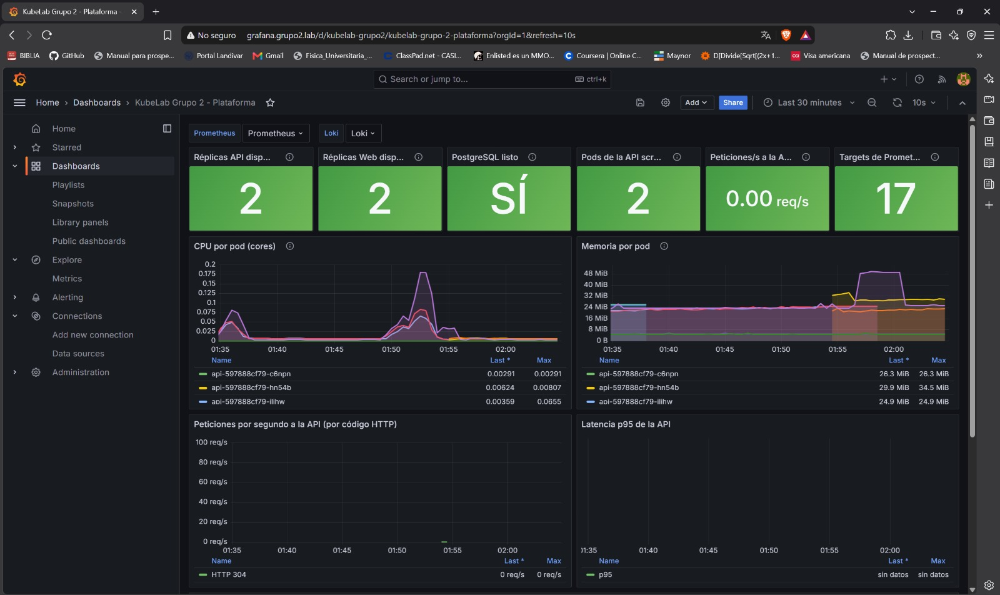

# Observability (OBS-01 to OBS-04, PER-02)

Everything runs in the `monitoring` namespace and is installed by Argo CD.

| Component | How | Persistence |
| :--- | :--- | :--- |
| Prometheus, Grafana, kube-state-metrics, node-exporter | Helm chart `kube-prometheus-stack` 65.2.0 (`k8s/argocd/obs-prometheus.yaml`) | Prometheus 2 Gi, Grafana 2 Gi |
| Loki and Promtail | Helm chart `loki-stack` 2.10.1 (`k8s/argocd/obs-loki.yaml`) | Loki 2 Gi |
| API scraping, dashboard, routes, Grafana secret | `k8s/observability/` | - |

## Prometheus (OBS-01)

- Node metrics from node-exporter and Kubernetes metrics from kube-state-metrics and the kubelet.
- The API `/metrics` endpoint is scraped through `k8s/observability/api-servicemonitor.yaml`.
- Available at `http://prometheus.grupo2.lab` (Status → Targets).

## Loki and Promtail (OBS-02)

Promtail runs as a DaemonSet, one pod per node, and sends the container logs to Loki.

## Grafana (OBS-03)

- Prometheus and Loki are configured as data sources in the Helm values (provisioning), not in the interface.
- The admin user and password come from Doppler (`grafana-admin-secret`).
- Available at `http://grafana.grupo2.lab`.

## Dashboard (OBS-04)

The dashboard *KubeLab Grupo 2 - Plataforma* is versioned in `k8s/observability/dashboard.yaml`. It shows available replicas of the API and web, PostgreSQL state, CPU and memory per pod, requests per second of the API, latency and a logs panel.

