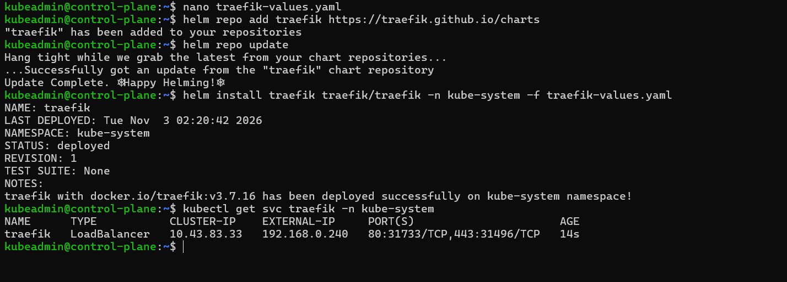
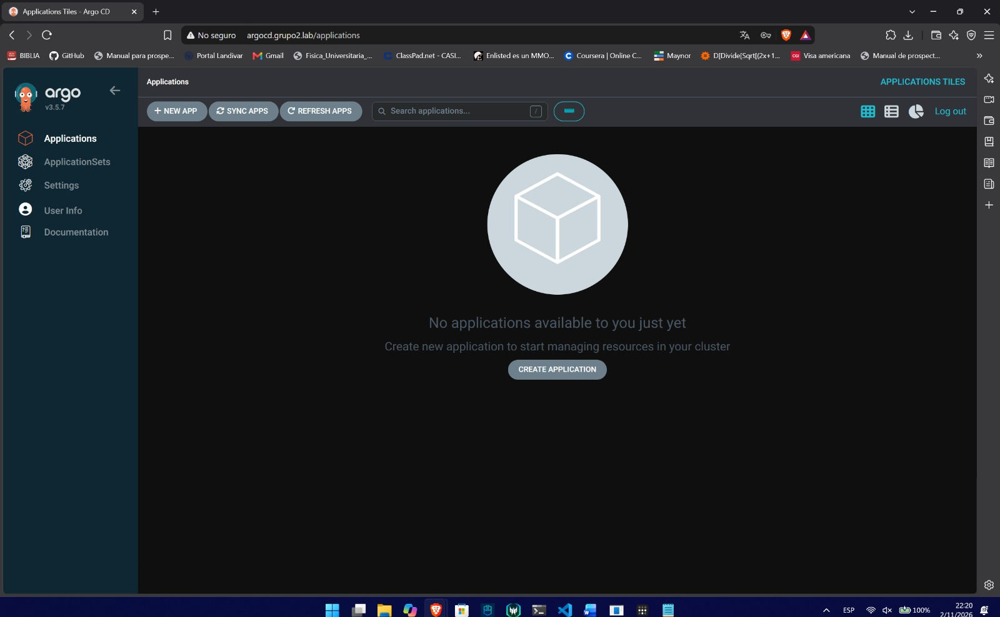

# Platform (NET-01, NET-02, PER-01, SEC-01, SEC-02, SEC-04, CD-02)

This document covers the components that run underneath the applications: MetalLB, Traefik, the storage class, Doppler and Argo CD.

## Bootstrap

A few pieces have to exist before Argo CD can manage the rest. They were installed once by hand from the control plane:

| Component | How | Why by hand |
| :--- | :--- | :--- |
| MetalLB | Official manifest | Provides the CRDs used by `k8s/platform/metallb/metallb-config.yaml` |
| Traefik | Helm chart `traefik/traefik` 42.2.0 with `k8s/platform/traefik/traefik-values.yaml` | Provides the `IngressRoute` CRDs used by every route in the repository |
| Argo CD | Installed in the `argocd` namespace | Argo CD cannot install itself |
| Doppler Kubernetes Operator | Installed once in the cluster | Provides the `DopplerSecret` CRD |
| `doppler-token-secret` | Created with `kubectl` | The only secret created by hand (SEC-04) |

After that, everything under `k8s/` is applied by Argo CD.

## MetalLB (NET-01)

MetalLB runs in layer 2 mode with the address pool reserved in the lab network (INF-06). File: `k8s/platform/metallb/metallb-config.yaml`.

```yaml
apiVersion: metallb.io/v1beta1
kind: IPAddressPool
metadata:
  name: first-pool
  namespace: metallb-system
spec:
  addresses:
  - 192.168.0.240-192.168.0.250
---
apiVersion: metallb.io/v1beta1
kind: L2Advertisement
metadata:
  name: example
  namespace: metallb-system
```

k3s was installed with `--disable servicelb`, so MetalLB is the only load balancer in the cluster.

## Traefik (NET-02)

Traefik is installed with Helm in `kube-system`:

```bash
helm upgrade --install traefik traefik --repo https://traefik.github.io/charts \
  --version 42.2.0 -n kube-system -f k8s/platform/traefik/traefik-values.yaml
```

`traefik-values.yaml` sets a `LoadBalancer` Service with the fixed IP `192.168.0.240` from the MetalLB pool, and adds a `postgres` entry point on port 5432 for the database (NET-04).

```yaml
service:
  type: LoadBalancer
  annotations:
    metallb.universe.tf/address-pool: first-pool
    metallb.universe.tf/loadBalancerIPs: 192.168.0.240
ports:
  postgres:
    port: 5432
    expose:
      default: true
    exposedPort: 5432
    protocol: TCP
```

Traefik got the external IP `192.168.0.240`:



## Storage (PER-01)

The cluster uses the `local-path-provisioner` bundled with k3s. Longhorn was discarded because it requires more memory than the workers have. `k8s/platform/storage/storage-class.yaml` declares `local-path` as the default StorageClass so it is part of the repository.

PostgreSQL, Prometheus, Loki and Grafana use PersistentVolumeClaims on that class (PER-02).

## Doppler (SEC-01, SEC-02, SEC-04)

- A Doppler project with a production config holds the database user, password and name, the Grafana admin user and password, and the `GIT_PAT` used by the pipelines.
- The Doppler Kubernetes Operator syncs them into Kubernetes Secrets through `DopplerSecret` resources in the repository:

| File | Kubernetes Secret | Used by |
| :--- | :--- | :--- |
| `k8s/apps/database/doppler-secret.yaml` | `postgres-secret` (`default`) | PostgreSQL and the API |
| `k8s/observability/doppler-grafana.yaml` | `grafana-admin-secret` (`monitoring`) | Grafana |

- The only secret created by hand is `doppler-token-secret`, which holds the Doppler service token. It was created with `kubectl` and its value is not stored in the repository.
- No password appears in the manifests or in the commit history.

## Argo CD (CD-02, CD-03)

Argo CD runs in the `argocd` namespace with `argocd-server` in insecure mode, so Traefik handles the HTTP route. The interface is published at `http://argocd.grupo2.lab` by `k8s/platform/argocd-ingress.yaml`.



The Applications are described in [cicd-gitops.md](cicd-gitops.md).
