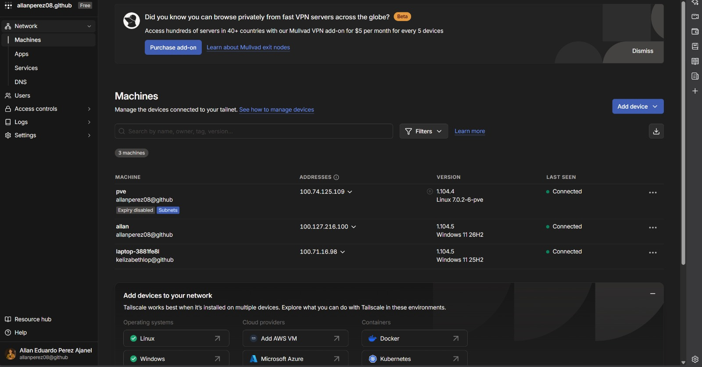
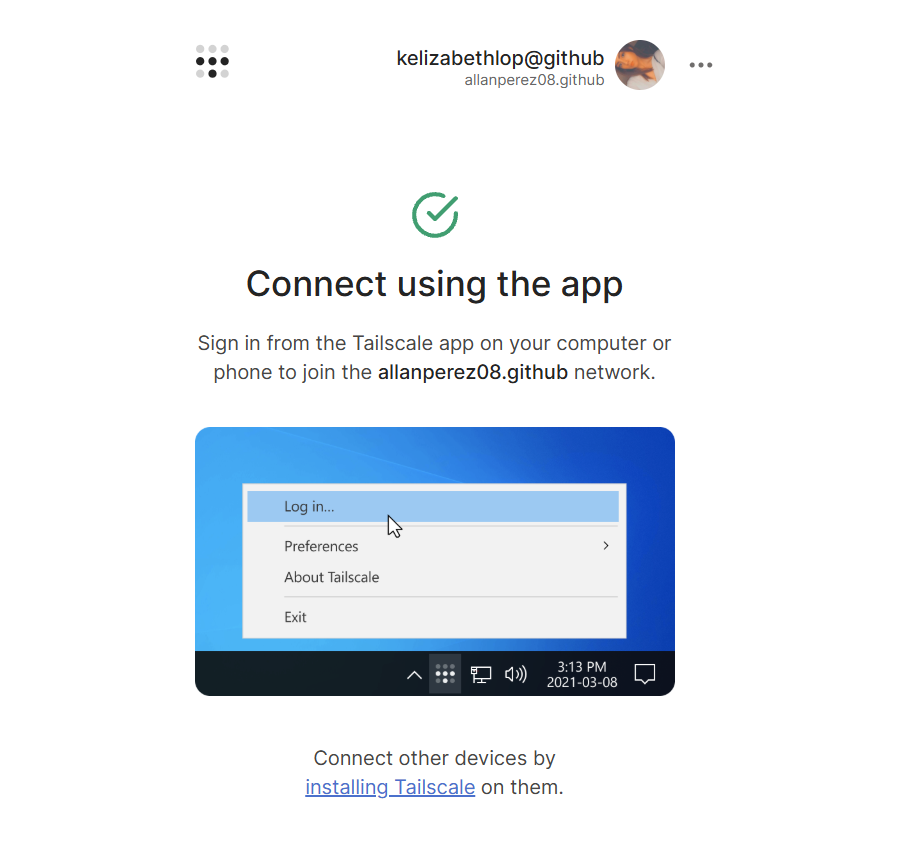
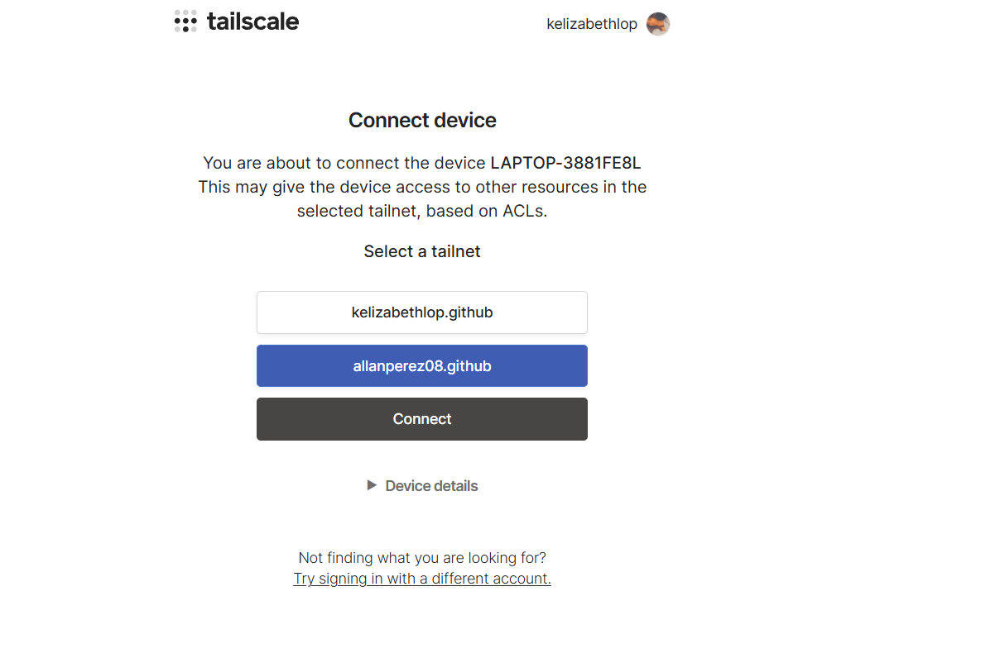
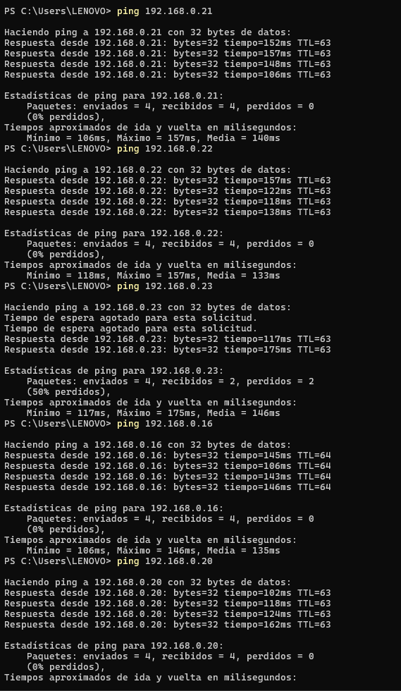
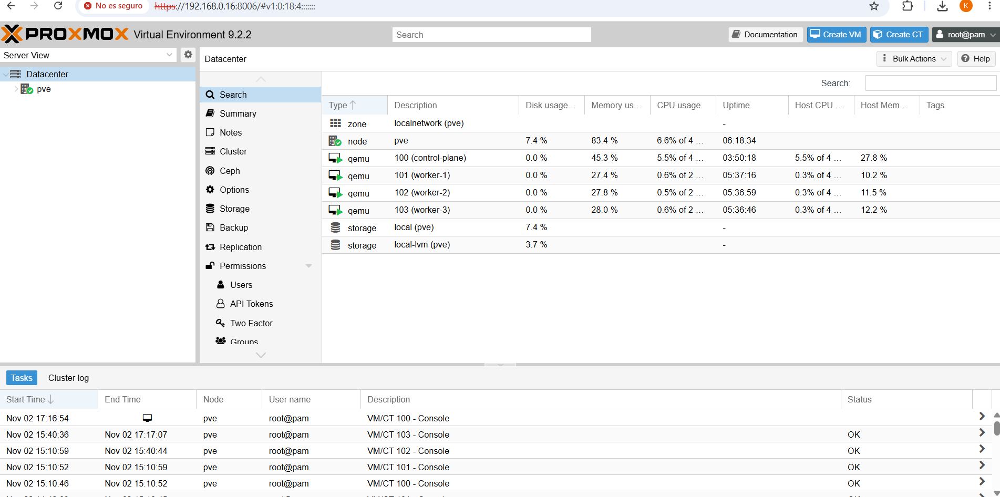

# Access (ACC-01 and ACC-02)

Access to the cluster network is provided by Tailscale with a subnet router on Proxmox. This lets the teacher reach Proxmox, the nodes and the Traefik IP from any network, without opening ports.

## How it works

```
Teacher (Tailscale) ──► pve (subnet router) ──► lab network 192.168.0.0/24
                                                  ├─ 192.168.0.16   Proxmox
                                                  ├─ 192.168.0.20   control-plane
                                                  ├─ 192.168.0.21   worker-1
                                                  ├─ 192.168.0.22   worker-2 (not in the final cluster)
                                                  ├─ 192.168.0.23   worker-3 (not in the final cluster)
                                                  └─ 192.168.0.240  Traefik (MetalLB)
```

- Tailscale is installed only on the Proxmox host (`pve`). The VMs have nothing installed.
- `pve` advertises the `192.168.0.0/24` route to the Tailscale network (tailnet `allanperez08.github`).
- When a device on the VPN wants to reach a `192.168.0.x` IP, the traffic enters through `pve` and is forwarded to the VM.

### Why not ZeroTier

We first set up ZeroTier, but its free plan no longer allows Managed Routes. Without that route, the teacher would have had to add it manually with `route add` on their computer. With Tailscale, subnet routers are included in the free plan and on Windows and macOS the route is accepted automatically. ZeroTier was uninstalled from Proxmox.

## Proxmox configuration

All commands were run on the `pve` console as root.

1. Packet forwarding, so `pve` can work as a router:

```bash
echo "net.ipv4.ip_forward=1" > /etc/sysctl.d/99-forward.conf
echo "net.ipv6.conf.all.forwarding = 1" >> /etc/sysctl.d/99-forward.conf
sysctl --system
```

2. Install Tailscale and advertise the route:

```bash
curl -fsSL https://tailscale.com/install.sh | sh
tailscale up --advertise-routes=192.168.0.0/24
```

The command prints a login link, which was opened with the tailnet owner's account.

3. In the admin console (login.tailscale.com), under **Machines → pve**:
   - **Edit route settings** → `192.168.0.0/24` was approved.
   - **Disable key expiry**, so `pve` does not disconnect when its key expires.

4. Check on `pve`:

```bash
tailscale status
```

In the admin console, `pve` appears as **Connected** with the **Subnets** and **Expiry disabled** tags, together with the devices that joined the tailnet:



## Instructions for the teacher

### 1. Join the VPN

1. Accept the invitation sent by email. The invitation uses the **Member** role, which can use the network but cannot change its configuration. After accepting it, this page appears:



2. Install Tailscale from https://tailscale.com/download.
3. Sign in with the invited email and, when asked which tailnet to use, choose **allanperez08.github**.



4. Check that it says **Connected**.
   - Windows: right-click the Tailscale icon and make sure **Use Tailscale subnets** is checked.
   - macOS: in the Tailscale menu, turn on **Use Tailscale subnets**.
   - Linux: connect with `sudo tailscale up --accept-routes`.
5. Test the connection:

```
ping 192.168.0.16
ping 192.168.0.20
```

### 2. Copy the zone file (ACC-01)

Copy the content of [hosts.txt](hosts.txt) into the hosts file:

- Windows: `C:\Windows\System32\drivers\etc\hosts` (open Notepad as administrator).
- Linux / macOS: `/etc/hosts` (with `sudo`).

```
# Grupo 2 - KubeLab
192.168.0.240 app.grupo2.lab
192.168.0.240 api.grupo2.lab
192.168.0.240 db.grupo2.lab
192.168.0.240 grafana.grupo2.lab
192.168.0.240 prometheus.grupo2.lab
192.168.0.240 argocd.grupo2.lab
```

### 3. Open the services

| URL | Service | What you should see |
| :--- | :--- | :--- |
| https://192.168.0.16:8006 | Proxmox VE | Proxmox dashboard with the `pve` node and its VMs |
| http://app.grupo2.lab | Web application | Page to list, create, edit and delete records |
| http://api.grupo2.lab/health | API | API health response |
| db.grupo2.lab | Database | Connection from a SQL client |
| http://grafana.grupo2.lab | Grafana | Dashboard with CPU, memory, replicas, requests and logs |
| http://prometheus.grupo2.lab | Prometheus | Targets in UP state |
| http://argocd.grupo2.lab | Argo CD | Applications in Synced and Healthy state |

Read-only credentials for the database, Grafana and Argo CD are shared through a private channel. They are not stored in this repository.

## Test

From a laptop connected to a phone hotspot (outside the lab network) and joined to the tailnet as a Member:

| Destination | Device | Result |
| :--- | :--- | :--- |
| 192.168.0.16 | Proxmox | replies, TTL 64 |
| 192.168.0.20 | control-plane | replies, TTL 63 |
| 192.168.0.21 | worker-1 | replies, TTL 63 |
| 192.168.0.22 | worker-2 | replies, TTL 63 |
| 192.168.0.23 | worker-3 | replies, TTL 63 |
| https://192.168.0.16:8006 | Proxmox web interface | loads |

TTL 63 on the VMs shows that traffic goes through `pve`, one hop more than Proxmox.





## Troubleshooting

| Problem | What to check |
| :--- | :--- |
| No ping replies at all | Tailscale says Connected and the `allanperez08.github` tailnet was selected |
| `pve` replies on its 100.x IP but not the 192.168.0.x IPs | The route is approved in the admin console and Use Tailscale subnets is on |
| The teacher's local network is also 192.168.0.x | The local network takes priority over the VPN. Connect from another network, for example a phone hotspot |
| The first pings are lost | Normal the first time, while the network finds the VM |
